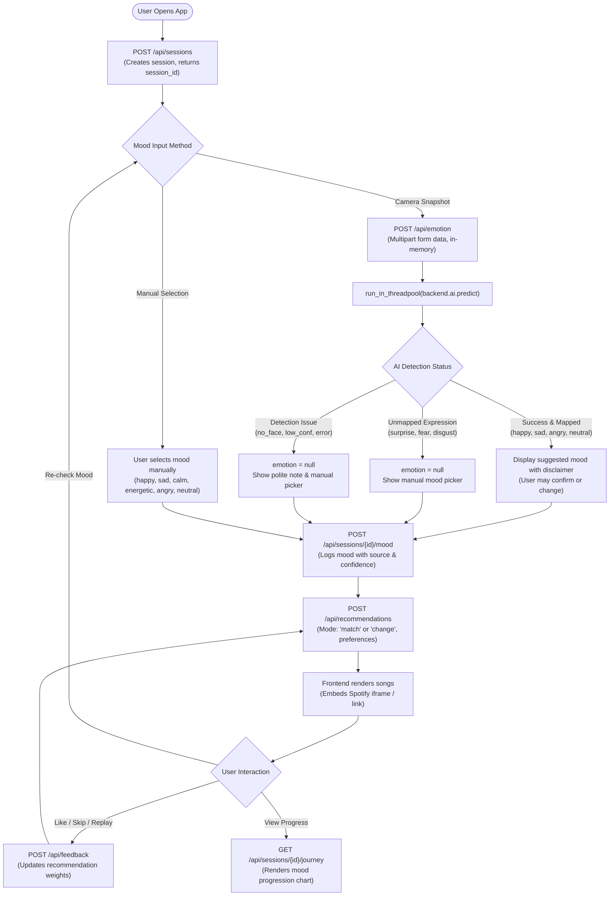

# VibeShift API & Module Contract

**Version:** `1.0.0`  
**Authors:** Milu (Member 3 – AI Developer & Team Lead) & Nethra (Member 4 – Backend Developer)  
**Target Consumers:** Prapthi (Member 1 – Frontend Developer) & Saakshi (Member 2 – UI/UX Designer)  
**Base URL:** `http://127.0.0.1:8000` (All endpoints prefixed with `/api`)  
**CORS Allowed Origins:** `http://localhost:5173`, `http://127.0.0.1:5173` (Credentials enabled, all methods and headers permitted)

---

## 1. Summary of All Endpoints

| # | Method | URL Path | Purpose | Content-Type | Status Code |
|---|--------|----------|---------|--------------|-------------|
| 1 | `GET` | `/api/health` | Server health check | None | `200 OK` |
| 2 | `POST` | `/api/recommendations` | Get top 10 recommended songs based on mood and feedback | `application/json` | `200 OK` |
| 3 | `POST` | `/api/sessions` | Initialize a new user listening session | `application/json` | `201 Created` |
| 4 | `POST` | `/api/sessions/{id}/mood` | Log a confirmed mood entry in session journey | `application/json` | `200 OK` |
| 5 | `GET` | `/api/sessions/{id}/journey` | Retrieve chronological mood history for charts | None | `200 OK` |
| 6 | `POST` | `/api/feedback` | Record user interaction (`like`, `skip`, `replay`) | `application/json` | `200 OK` |
| 7 | `POST` | `/api/emotion` | Estimate facial expression from uploaded photo | `multipart/form-data` | `200 OK` |

---

## 2. End-to-End User Flow & State Machine

The following diagram illustrates the interaction between the frontend client, backend routers, SQLite database, and the internal AI module across a user's listening session:



---

## 3. REST API Specifications

### 1. Health Check

#### `GET /api/health`
Checks whether the backend server is operational.

* **Request Headers:** None
* **Request Body:** None
* **Success Response (`200 OK`):**
  ```json
  {
    "status": "ok"
  }
  ```

---

### 2. Song Recommendations

#### `POST /api/recommendations`
Returns the top 10 recommended songs based on user mood, preferences, and feedback history.

> [!IMPORTANT]
> **Spotify Link Playback (`audio_url`):**  
> The `audio_url` field provides an external **Spotify track link** (e.g. `https://open.spotify.com/track/0OA00aPt3BV10qeMIs3meW`), **not a raw audio file**.  
> The frontend should embed this link via Spotify's iframe embed player or open it in a new tab. It cannot be passed to an HTML5 `<audio>` tag.

> [!NOTE]
> **Recommendation Scoring & Session Scope:**  
> In the current implementation, `POST /api/recommendations` scores songs based on **global feedback** accumulated across all sessions in the database, because `session_id` is not currently accepted in the request payload. Support for session-isolated feedback weighting is an architectural candidate for future iterations.

* **Content-Type:** `application/json`

#### Request Body
```json
{
  "current_mood": "happy",
  "mode": "match",
  "target_mood": null,
  "language": "English",
  "genre": "Pop",
  "context": "workout"
}
```

| Field | Type | Required | Description |
|---|---|---|---|
| `current_mood` | `string` | **Yes** | Current detected or selected mood: `happy`, `sad`, `calm`, `energetic`, `angry`, `neutral` |
| `mode` | `string` | No (default: `"match"`) | `"match"` (stay in current mood) or `"change"` (transition towards target mood) |
| `target_mood` | `string` / `null` | Required if `mode == "change"` | Desired target mood when mode is `"change"` |
| `language` | `string` / `null` | No | Optional language filter: `Malayalam`, `Hindi`, `English`, `Tamil` |
| `genre` | `string` / `null` | No | Optional genre filter: `Melody`, `Pop`, `Rock`, `Classical`, `Dance` |
| `context` | `string` / `null` | No | Optional activity context: `relax`, `study`, `workout`, `travel`, `party`, `sleep` |

#### Success Response (`200 OK`)
```json
[
  {
    "id": 1,
    "title": "Big Dawgs",
    "artist": "Hanumankind, Kalmi",
    "language": "English",
    "genre": "Pop",
    "mood_tags": [
      "angry",
      "energetic"
    ],
    "audio_url": "https://open.spotify.com/track/0OA00aPt3BV10qeMIs3meW"
  },
  {
    "id": 2,
    "title": "Bye Bye Bye - From Deadpool and Wolverine Soundtrack",
    "artist": "*NSYNC",
    "language": "English",
    "genre": "Pop",
    "mood_tags": [
      "happy",
      "energetic"
    ],
    "audio_url": "https://open.spotify.com/track/62bOmKYxYg7dhrC6gH9vFn"
  }
]
```

#### Response Item Fields
| Field | Type | Description |
|---|---|---|
| `id` | `integer` | Unique song ID |
| `title` | `string` | Song title |
| `artist` | `string` | Artist name |
| `language` | `string` | Song language |
| `genre` | `string` | Song genre |
| `mood_tags` | `array of strings` | Mood tags associated with the song (e.g. `["happy", "energetic"]`) |
| `audio_url` | `string` | **Spotify track link** (`https://open.spotify.com/track/...`). Open or embed in Spotify player. |

#### Error Responses
* **`400 Bad Request`**: When `mode` is neither `"match"` nor `"change"`, or when `mode` is `"change"` and `target_mood` is missing:
  ```json
  {
    "detail": "target_mood is required when mode is 'change'."
  }
  ```
* **`500 Internal Server Error`**: Raised if database scoring encounters an unexpected error:
  ```json
  {
    "detail": "An error occurred while generating recommendations: <error_message>"
  }
  ```

---

### 3. Create Session

#### `POST /api/sessions`
Initializes a new listening session to track mood transitions and song feedback.

* **Content-Type:** `application/json`

#### Request Body (All fields optional)
```json
{
  "language": "English",
  "genre": "Pop",
  "context": "workout"
}
```

| Field | Type | Required | Description |
|---|---|---|---|
| `language` | `string` / `null` | No | Preferred language filter (`Malayalam`, `Hindi`, `English`, `Tamil`) |
| `genre` | `string` / `null` | No | Preferred genre filter (`Melody`, `Pop`, `Rock`, `Classical`, `Dance`) |
| `context` | `string` / `null` | No | Activity context (`relax`, `study`, `workout`, `travel`, `party`, `sleep`) |

#### Success Response (`201 Created`)
```json
{
  "session_id": 1,
  "created_at": "2026-11-13 14:00:00"
}
```

#### Response Fields
| Field | Type | Description |
|---|---|---|
| `session_id` | `integer` | Unique auto-generated integer ID of the session |
| `created_at` | `string` | Creation timestamp (`YYYY-MM-DD HH:MM:SS`) |

---

### 4. Record Session Mood

#### `POST /api/sessions/{id}/mood`
Records a confirmed mood entry into the session journey.

* **Path Parameter:** `id` (`integer`, required) — The unique integer ID of the session
* **Content-Type:** `application/json`

#### Request Body
```json
{
  "mood": "sad",
  "source": "manual",
  "confidence": 0.95
}
```

| Field | Type | Required | Description |
|---|---|---|---|
| `mood` | `string` | **Yes** | One of: `happy`, `sad`, `calm`, `energetic`, `angry`, `neutral` |
| `source` | `string` | No (default: `"manual"`) | One of: `manual`, `camera_suggested`, `recheck` |
| `confidence` | `float` / `null` | No (default: `1.0`) | Confidence score between `0.0` and `1.0` |

#### Success Response (`200 OK`)
```json
{
  "message": "Mood recorded successfully",
  "session_id": 1,
  "mood": "sad",
  "source": "manual",
  "confidence": 0.95,
  "recorded_at": "2026-11-13 14:01:15"
}
```

#### Response Fields
| Field | Type | Description |
|---|---|---|
| `message` | `string` | Status confirmation message |
| `session_id` | `integer` | Active session ID |
| `mood` | `string` | Recorded mood |
| `source` | `string` | Source of mood entry (`manual`, `camera_suggested`, `recheck`) |
| `confidence` | `float` / `null` | Recorded confidence score |
| `recorded_at` | `string` | Recording timestamp (`YYYY-MM-DD HH:MM:SS`) |

#### Error Responses
* **`400 Bad Request`**: Invalid mood or invalid source:
  ```json
  {
    "detail": "Invalid mood 'excited'. Allowed moods are: angry, calm, energetic, happy, neutral, sad."
  }
  ```
* **`404 Not Found`**: Session ID does not exist:
  ```json
  {
    "detail": "Session with ID 99 not found."
  }
  ```

---

### 5. Get Session Mood Journey

#### `GET /api/sessions/{id}/journey`
Retrieves chronological mood progression for a session (oldest first), formatted for frontend charts.

* **Path Parameter:** `id` (`integer`, required) — The unique integer ID of the session
* **Request Body:** None

#### Success Response (`200 OK`)
```json
{
  "session_id": 1,
  "entries": [
    {
      "mood": "sad",
      "source": "manual",
      "recorded_at": "2026-11-13 14:00:10"
    },
    {
      "mood": "neutral",
      "source": "recheck",
      "recorded_at": "2026-11-13 14:15:00"
    },
    {
      "mood": "happy",
      "source": "camera_suggested",
      "recorded_at": "2026-11-13 14:30:30"
    }
  ]
}
```
*Note: If no moods have been recorded yet for an active session, an empty list `{"session_id": 1, "entries": []}` is returned.*

#### Entry Item Fields
| Field | Type | Description |
|---|---|---|
| `mood` | `string` | Logged mood value |
| `source` | `string` | Entry source (`manual`, `camera_suggested`, `recheck`) |
| `recorded_at` | `string` | Timestamp when mood was recorded |

#### Error Responses
* **`404 Not Found`**: Session ID does not exist:
  ```json
  {
    "detail": "Session with ID 99 not found."
  }
  ```

---

### 6. Record Song Feedback

#### `POST /api/feedback`
Records user interactions on a song (`like`, `skip`, or `replay`). These actions influence recommendation scoring.

* **Content-Type:** `application/json`

#### Request Body
```json
{
  "session_id": 1,
  "song_id": 5,
  "action": "like"
}
```

| Field | Type | Required | Description |
|---|---|---|---|
| `session_id` | `integer` | **Yes** | ID of the active listening session |
| `song_id` | `integer` | **Yes** | ID of the song |
| `action` | `string` | **Yes** | One of: `"like"`, `"skip"`, `"replay"` |

#### Success Response (`200 OK`)
```json
{
  "message": "Feedback recorded successfully",
  "session_id": 1,
  "song_id": 5,
  "action": "like"
}
```

#### Response Fields
| Field | Type | Description |
|---|---|---|
| `message` | `string` | Status confirmation message |
| `session_id` | `integer` | Active session ID |
| `song_id` | `integer` | Acted song ID |
| `action` | `string` | Recorded action (`like`, `skip`, `replay`) |

#### Error Responses
* **`400 Bad Request`**: Invalid action:
  ```json
  {
    "detail": "Invalid action 'dislike'. Allowed actions are: like, replay, skip."
  }
  ```
* **`404 Not Found`**: Session or song does not exist:
  ```json
  {
    "detail": "Session with ID 99 not found."
  }
  ```
  or
  ```json
  {
    "detail": "Song with ID 999 not found."
  }
  ```

---

### 7. Estimate Emotion from Facial Image

#### `POST /api/emotion`
Uploads a user facial photo in-memory to estimate visible facial expression using `backend.ai.predict`.

> [!IMPORTANT]
> **Privacy & Security Guarantee:**  
> Uploaded images are held strictly in RAM for inference and are **never saved to disk or permanent storage**.

> [!NOTE]
> **Upload-Size Limit & Recommendations:**  
> * **Backend Implementation:** The backend currently enforces MIME types and non-empty file checks (`len(image_bytes) > 0`). There is **no hard file-size ceiling (HTTP 413)** currently enforced in backend middleware.
> * **Frontend Recommendation:** The frontend should enforce a client-side limit (recommended maximum: **5 MB**) prior to uploading. Capturing JPEG snapshots at $640 \times 480$ or $1280 \times 720$ with quality $0.8$ keeps payloads well below 500 KB, reducing upload latency and memory usage on CPU inference.

* **Content-Type:** `multipart/form-data`
* **Form Data:**
  * `file`: Image binary (`.jpg`, `.jpeg`, `.png`, `.webp`, `.bmp`)

| Field | Type | Required | Description |
|---|---|---|---|
| `file` | `binary` | **Yes** | Facial image file (`.jpg`, `.jpeg`, `.png`, `.webp`, `.bmp`) |

---

### Facial Expression-to-Mood Mapping Table (`EXPRESSION_TO_MOOD`)

Only clear, unambiguous expressions automatically map to a music mood. High-arousal or ambiguous expressions (`surprise`, `fear`, `disgust`) have **no automatic mood mapping**.

> [!IMPORTANT]
> **Safety & Fallback Policy:**  
> Whenever `emotion` is `null`, the frontend **must display the manual mood picker**. The system **never defaults silently to neutral**.

| AI Facial Expression | Mapped Music Mood (`emotion`) | Automatic? | Frontend Action & User Note |
|---|---|---|---|
| `happy` | `"happy"` | **Yes** | Display suggested mood with scientific disclaimer |
| `sad` | `"sad"` | **Yes** | Display suggested mood with scientific disclaimer |
| `angry` | `"angry"` | **Yes** | Display suggested mood with scientific disclaimer |
| `neutral` | `"neutral"` | **Yes** | Display suggested mood with scientific disclaimer |
| `surprise` | `null` | **No** | Prompt user to select mood manually |
| `fear` | `null` | **No** | Prompt user to select mood manually |
| `disgust` | `null` | **No** | Prompt user to select mood manually |
| *`calm`* | — | — | **Manual choice only** (musical mood; not a facial expression) |
| *`energetic`* | — | — | **Manual choice only** (musical mood; not a facial expression) |

---

### Detection Status Values & Behavior

The `status` field returns the exact pipeline state:

| Status Value | Meaning | `emotion` | `confidence` | Frontend Requirement |
|---|---|---|---|---|
| `success` | Face detected and decisive expression predicted | Mapped mood, or `null` if surprise/fear/disgust | Actual score (`0.0`–`1.0`) | If `emotion` is `null`, show manual mood picker |
| `no_face_detected` | Detector operational, but no human face was found | `null` | `0.0` placeholder | Prompt user to face camera or pick mood manually |
| `low_confidence` | Face found, but prediction is below confidence threshold | `null` | Low score (e.g. `0.28`) | Prompt user to adjust lighting or pick mood manually |
| `face_detector_unavailable` | OpenCV Haar cascade XML missing or uninitialized | `null` | `0.0` placeholder | Show manual mood picker |
| `model_weights_not_loaded` | Pretrained PyTorch weights not loaded | `null` | `0.0` placeholder | Show manual mood picker |
| `preprocessing_failed` | Face bounding box could not be cropped or normalized | `null` | `0.0` placeholder | Show manual mood picker |
| `invalid_image` | Image input could not be decoded or was malformed | `null` | `0.0` placeholder | Show manual mood picker |
| `error` | Unexpected runtime exception caught in threadpool | `null` | `0.0` placeholder | Show manual mood picker |

---

#### Response Schema

| Field | Type | Description |
|---|---|---|
| `emotion` | `string` or `null` | Detected music mood (`"happy"`, `"sad"`, `"angry"`, `"neutral"`), or `null` if unmapped, low confidence, or failed |
| `confidence` | `float` | Confidence score between `0.0` and `1.0` (rounded to 2 decimal places) |
| `status` | `string` | Exact status value from AI pipeline (see table above) |
| `note` | `string` | Disclaimer or user guidance prompt (asks user to choose mood manually when `emotion` is `null`) |

> **Confidence & Frontend Decision Rule:** When `emotion` is `null` and `status` is not `success`, `confidence` is `0.0`. This is a placeholder, not a real model prediction. The frontend must decide using `emotion` (`null`) and `status`, never `confidence` alone.

---

### Confidence Precision & Placeholder Clarification

* **External API Precision:** The external REST endpoint rounds `confidence` to **2 decimal places** (e.g. `0.88`, `0.76`, `0.28`) for clean client-side presentation.
* **Fallback Placeholder `0.0`:** Whenever detection fails, no face is found, or an unhandled exception occurs, `confidence` returns the fallback placeholder `0.0` (rather than `null`) to maintain schema consistency.
* **Internal AI Engine:** The internal AI module computes raw floating-point probabilities rounded to 4 decimal places (e.g. `0.8845`).

---

### HTTP Status Code Handling on `/api/emotion`

* **`200 OK` (Standard for both success and friendly AI runtime fallbacks):**
  To prevent unexpected client UI crashes, non-decisive predictions, missing faces, unmapped expressions, and caught runtime inference exceptions return `HTTP 200 OK` with `emotion: null`, the specific `status`, and a clear explanatory `note`.
* **`400 Bad Request` (Invalid or empty upload):**
  Raised only when the uploaded file is not a supported image format or contains zero bytes:
  ```json
  {
    "detail": "Invalid file format. Please upload a valid image file (JPEG, PNG, or WEBP)."
  }
  ```
  or
  ```json
  {
    "detail": "The uploaded image file is empty. Please upload a valid image."
  }
  ```

---

### Sample Responses for `POST /api/emotion` (`200 OK`)

**1. Successful Direct Mapping (`happy`):**
```json
{
  "emotion": "happy",
  "confidence": 0.88,
  "status": "success",
  "note": "This is only an estimate of facial expression, not proof of feelings."
}
```

**2. Ambiguous Expression (`surprise` $\rightarrow$ unmapped, returns `null`):**
```json
{
  "emotion": null,
  "confidence": 0.76,
  "status": "success",
  "note": "Detected facial expression is 'surprise', which has no direct music mood mapping. Please choose your mood manually."
}
```

**3. No Face Detected (`no_face_detected`):**
```json
{
  "emotion": null,
  "confidence": 0.0,
  "status": "no_face_detected",
  "note": "No face was detected in the photo. Please choose your mood manually."
}
```

**4. Low Confidence (`low_confidence`):**
```json
{
  "emotion": null,
  "confidence": 0.28,
  "status": "low_confidence",
  "note": "Facial expression confidence is low. Please choose your mood manually."
}
```

**5. Face Detector Unavailable (`face_detector_unavailable`):**
```json
{
  "emotion": null,
  "confidence": 0.0,
  "status": "face_detector_unavailable",
  "note": "Face detector is currently unavailable. Please choose your mood manually."
}
```

**6. AI Runtime Error Catch-all (`error`):**
```json
{
  "emotion": null,
  "confidence": 0.0,
  "status": "error",
  "note": "Emotion estimation encountered a temporary issue. Please choose your mood manually."
}
```

---

## 4. Internal Python AI Module Contract (`backend.ai`)

For developers working directly with the Python package (`backend.ai`), this section defines the internal interface and execution requirements.

### Function Signature
```python
from backend.ai import predict

result = predict(
    image_input: Union[bytes, bytearray, str, np.ndarray, Path],
    detector: Optional[FaceDetector] = None,
    model: Optional[EmotionModelInterface] = None,
) -> Dict[str, Any]
```

### Supported Input Types
The `decode_image()` preprocessor supports:
1. `bytes` or `bytearray`: Raw image binary (e.g. from FastAPI `await file.read()`).
2. `str`: Base64 data URI (`data:image/jpeg;base64,...`) or standard filesystem path.
3. `np.ndarray`: In-memory OpenCV image matrix (`BGR` or `RGB`).
4. `pathlib.Path`: Path object pointing to an image file.

### Internal Return Dictionary Schema
```python
{
    "face_detected": bool,                        # True if >= 1 face found
    "expression": Optional[str],                  # One of 7 AffectNet labels or None
    "confidence": Optional[float],                # Raw score rounded to 4 decimals (e.g. 0.8845)
    "status": str,                                # 'success', 'low_confidence', 'no_face_detected', etc.
    "disclaimer": str,                            # Mandatory scientific disclaimer
    "bbox": Optional[List[int]],                  # [x, y, w, h] of primary face
    "expression_scores": Optional[Dict[str, float]], # Softmax distribution over all 7 classes
    "latency_ms": float                           # Pipeline execution duration in milliseconds
}
```

### Threadpool Execution Requirement
Because PyTorch inference and OpenCV Haar cascade evaluation are CPU-bound and hold the Python GIL, FastAPI routes **must not** call `predict()` synchronously in `async def` endpoints. Always wrap execution using Starlette/FastAPI's threadpool:

```python
from fastapi.concurrency import run_in_threadpool
from backend.ai import predict

raw_result = await run_in_threadpool(predict, image_bytes)
```

### Contract Comparison: External REST API vs. Internal AI Module

| Property | External REST API (`POST /api/emotion`) | Internal AI Module (`backend.ai.predict`) |
|---|---|---|
| **Protocol** | HTTP / Multipart Form | Python function call |
| **Input** | `UploadFile` binary | `bytes`, `str`, `np.ndarray`, `Path` |
| **Output Type** | Pydantic model (`EmotionResponse`) | Python dictionary |
| **Emotion Keys** | `emotion` (music mood: `happy`, `sad`, `angry`, `neutral`, or `null`) | `expression` (AffectNet label: 7 classes) |
| **Confidence Format** | `float` rounded to 2 decimal places (`0.88`) | `float` rounded to 4 decimal places (`0.8845`) |
| **Internal Diagnostics** | Hidden (`bbox`, `scores`, `latency` omitted) | Exposed (`bbox`, `expression_scores`, `latency_ms`) |

---

## 5. Frontend Integration Guidelines

### Recommended Camera Capture Settings
To ensure reliable face detection and minimal latency:
1. **Resolution:** Request a $4:3$ or $16:9$ portrait or square frame, ideally $640 \times 480$ or $1280 \times 720$:
   ```javascript
   const constraints = {
     video: {
       width: { ideal: 640 },
       height: { ideal: 480 },
       facingMode: "user"
     }
   };
   ```
2. **Snapshot Extraction:** Draw the video frame to an off-screen `<canvas>` and convert to Blob using JPEG compression ($0.8$ quality):
   ```javascript
   canvas.toBlob((blob) => {
     if (!blob) return;
     if (blob.size > 5 * 1024 * 1024) {
       console.warn("Client file size exceeds recommended 5 MB limit.");
       return;
     }
     const formData = new FormData();
     formData.append("file", blob, "camera_frame.jpg");
     
     // POST to /api/emotion
   }, "image/jpeg", 0.8);
   ```

---

### Complete TypeScript Interfaces

```typescript
/**
 * VibeShift API Type Definitions
 */

export type Mood = 'happy' | 'sad' | 'calm' | 'energetic' | 'angry' | 'neutral';

export type MoodSource = 'manual' | 'camera_suggested' | 'recheck';

export type RecommendationMode = 'match' | 'change';

export type FeedbackAction = 'like' | 'skip' | 'replay';

export type EmotionStatus =
  | 'success'
  | 'no_face_detected'
  | 'low_confidence'
  | 'model_weights_not_loaded'
  | 'face_detector_unavailable'
  | 'preprocessing_failed'
  | 'invalid_image'
  | 'error';

// ============================================================================
// 1. Health
// ============================================================================
export interface HealthResponse {
  status: 'ok';
}

// ============================================================================
// 2. Emotion Estimation
// ============================================================================
export interface EmotionResponse {
  emotion: Mood | null;
  confidence: number;
  note: string;
  status: EmotionStatus | null;
}

// ============================================================================
// 3. Recommendations
// ============================================================================
export interface RecommendationRequest {
  current_mood: Mood;
  mode?: RecommendationMode;
  target_mood?: Mood | null;
  language?: string | null;
  genre?: string | null;
  context?: string | null;
}

export interface SongResponse {
  id: number;
  title: string;
  artist: string;
  language: string;
  genre: string;
  mood_tags: string[];
  audio_url: string; // Spotify track link: https://open.spotify.com/track/...
}

// ============================================================================
// 4. Sessions
// ============================================================================
export interface SessionCreateRequest {
  language?: string | null;
  genre?: string | null;
  context?: string | null;
}

export interface SessionResponse {
  session_id: number;
  created_at: string;
}

export interface RecordMoodRequest {
  mood: Mood;
  source?: MoodSource;
  confidence?: number | null;
}

export interface RecordMoodResponse {
  message: string;
  session_id: number;
  mood: Mood;
  source: MoodSource;
  confidence: number | null;
  recorded_at: string;
}

export interface MoodEntry {
  mood: Mood;
  source: MoodSource;
  recorded_at: string;
}

export interface JourneyResponse {
  session_id: number;
  entries: MoodEntry[];
}

// ============================================================================
// 5. Feedback
// ============================================================================
export interface FeedbackRequest {
  session_id: number;
  song_id: number;
  action: FeedbackAction;
}

export interface FeedbackResponse {
  message: string;
  session_id: number;
  song_id: number;
  action: FeedbackAction;
}
```

---

## 6. Database Schema Reference

SQLite database location: `backend/database/vibeshift.db`

### Table Definitions

```sql
-- 1. Songs Catalog (Seeded from backend/data/songs.csv on startup)
CREATE TABLE IF NOT EXISTS songs (
    id INTEGER PRIMARY KEY,
    title TEXT NOT NULL,
    artist TEXT NOT NULL,
    language TEXT NOT NULL,
    genre TEXT NOT NULL,
    mood_tags TEXT NOT NULL,     -- Pipe-separated (e.g. "happy|energetic")
    context_tags TEXT NOT NULL,  -- Pipe-separated (e.g. "workout|party")
    audio_url TEXT NOT NULL      -- Spotify track URL
);

-- 2. Listening Sessions
CREATE TABLE IF NOT EXISTS sessions (
    session_id INTEGER PRIMARY KEY AUTOINCREMENT,
    language TEXT,
    genre TEXT,
    context TEXT,
    created_at TIMESTAMP DEFAULT CURRENT_TIMESTAMP
);

-- 3. Session Mood History (Journey)
CREATE TABLE IF NOT EXISTS mood_records (
    id INTEGER PRIMARY KEY AUTOINCREMENT,
    session_id INTEGER NOT NULL,
    mood TEXT NOT NULL,
    confidence REAL DEFAULT 1.0,
    source TEXT DEFAULT 'manual',
    recorded_at TIMESTAMP DEFAULT CURRENT_TIMESTAMP,
    FOREIGN KEY (session_id) REFERENCES sessions (session_id) ON DELETE CASCADE
);

-- 4. User Feedback History
CREATE TABLE IF NOT EXISTS feedback (
    id INTEGER PRIMARY KEY AUTOINCREMENT,
    session_id INTEGER,
    song_id INTEGER NOT NULL,
    action TEXT NOT NULL,        -- 'like', 'skip', or 'replay'
    timestamp TIMESTAMP DEFAULT CURRENT_TIMESTAMP,
    FOREIGN KEY (session_id) REFERENCES sessions (session_id) ON DELETE SET NULL,
    FOREIGN KEY (song_id) REFERENCES songs (id) ON DELETE CASCADE
);
```
